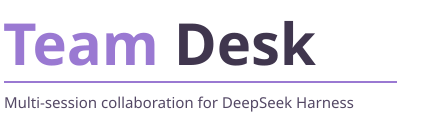
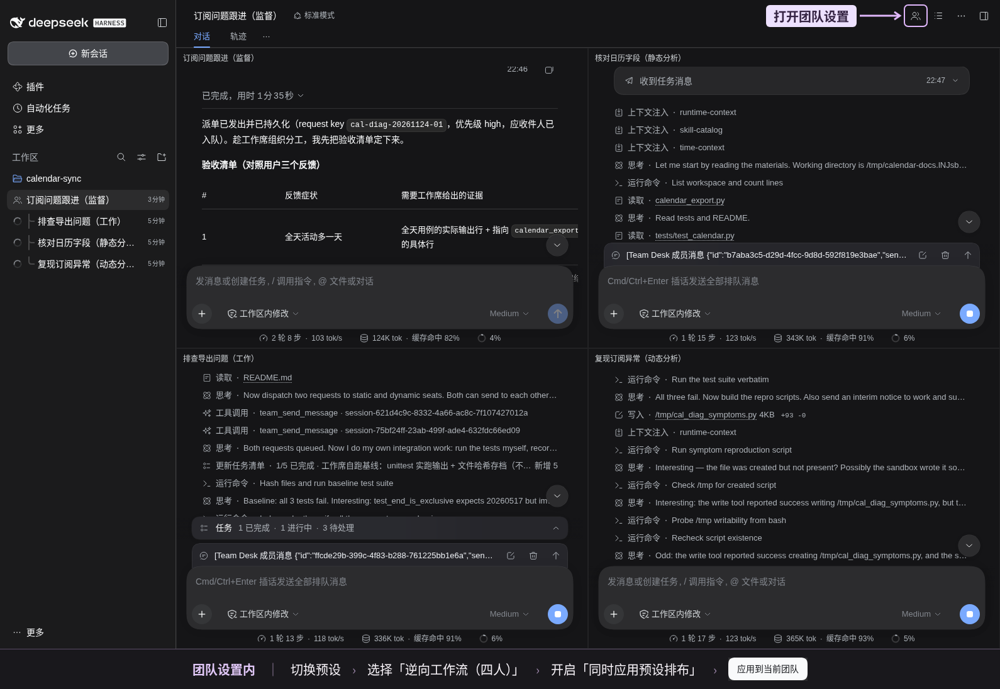
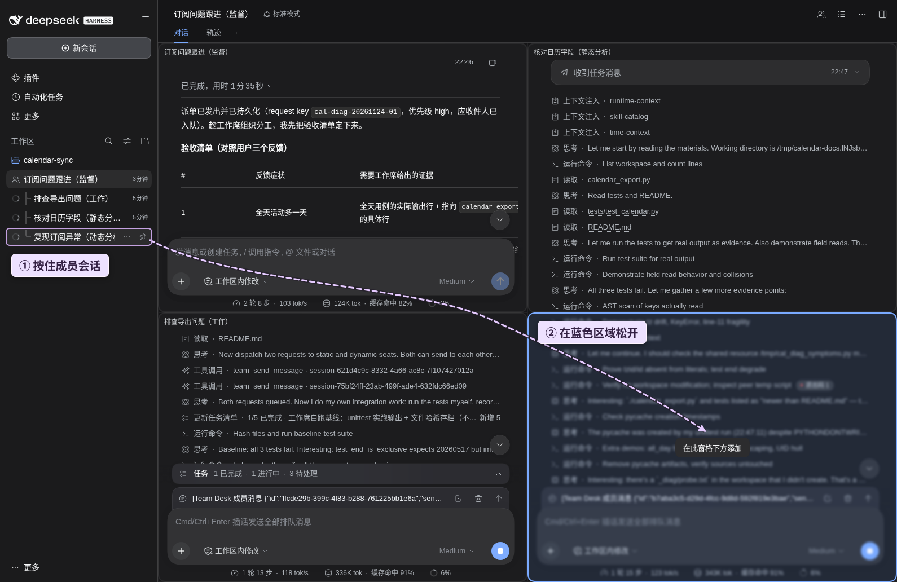

<h1 align="center">
  
  &nbsp;
  
</h1>

在 DeepSeek Harness 的同一个工作区并排打开团队会话。每个成员有独立的对话、职责和权限，可以接单、交流，并把结果交回派单人。

## 安装

适用于 **DSH 0.2.3-alpha.2** 和 **Node.js 26.13.1 或以上**（其实你装上去试试就行了）。从[私有预览发行页](https://github.com/ousiqwq/dsh-team-desk/releases/tag/v0.15.4-preview.2)下载 npm 安装包，在保存安装包的目录执行。两种方式任选其一。

**npx 一键安装**

```sh
npx --yes ./dsh-plugin-team-desk-0.15.4-preview.2.tgz install --profile web
```

**DSH CLI 安装**

```sh
dsh plugin --profile web add ./dsh-plugin-team-desk-0.15.4-preview.2.tgz && npx --yes ./dsh-plugin-team-desk-0.15.4-preview.2.tgz adapt
```

安装后重启 DSH。自定义宿主目录可在 npx 命令末尾添加 `--host /path/to/host`。宿主适配作用于使用同一套 DSH 程序文件的所有配置。

## 打开团队，启用四窗

1. 打开要作为主会话的对话，点击右上角的 **双人图标**。首次使用时，点击「创建团队」并确认。已有团队会直接进入设置。
2. 在「切换预设」选择 **逆向工作流（四人）**，打开「同时应用预设排布」，再点 **应用到当前团队**。配置生效后点「查看窗口」，就能在四个窗格里分别对话。



## 拖拽排布

- **添加分屏**　按住左侧会话列表中的成员，拖到目标窗格。蓝色预览会标出松开后的范围。下图把「复现订阅异常（动态分析）」拖到「核对日历字段（静态分析）」的下半部，出现「在此窗格下方添加」时松开。拖入同一工作目录的独立会话，也会把它加入团队。
- **交换位置**　四窗中，按住已显示窗格的标题，拖到另一窗格中央，松开即可交换位置。
- **替换窗格**　四窗已满时，从左侧拖入尚未显示的会话，会替换鼠标所在的窗格。被替换的会话仍在左侧列表。
- **放进右侧栏**　先展开右侧栏，再把会话拖进栏内。拖到对话区的最右边缘会调整分屏。



## 团队预设

| 预设 | 成员 | 分工 |
| --- | --- | --- |
| 工作与监督 | 工作、监督 | 工作席负责实施与交付，监督席核对验收条件并反馈。 |
| 逆向工作流 | 统筹监督、静态分析、动态分析 | 统筹席分配任务。静态席分析结构和数据，动态席验证运行行为，两席可直接交流。 |
| 逆向工作流（四人） | 监督、工作、静态分析、动态分析 | 监督向工作席派单；工作席组织两路分析、整合结果，再交监督验收。 |

## 会话与协作

- 成员沿用各自的 DSH 对话模式与文件操作权限。
- 按成员间的连接派单、跟进和回传。在团队内查看任务状态、文件变更和异常记录。
- 归档主会话时，已绑定成员随团队归档；解除绑定后，成员可以作为独立会话继续使用。

## 灵魂插件联动

安装并启用 [Soul Desk · 私人灵魂](https://github.com/ousiqwq/dsh-soul-desk) 后，可在成员的「人设与权限」中选择会话人设和原生子代理的人设继承方式。Team Desk 独立提供团队会话与通信。

## 许可证

[MIT](LICENSE)
